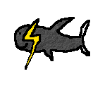

## NetSurfy

This is a lightweight browser written in C that uses GTK4. It's a fork of NetSurfy.

### Building NetSurfy

* Read the [Quick Start](docs/quick-start.md) document for instructions.
* In short: `cmake -B build && cmake --build build && ./build/netsurfy`

### General info

* Version: 1.0.4
* License: MIT and GPL2, see the `LICENSE` file for more information.
