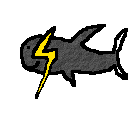

## TinySurf

This is a lightweight browser written in C that uses GTK4. It's a fork of NetSurf.

### Building

cmake -B build && cmake --build build

### General info

* Version: 1.1.8
* License: MIT and GPL2, see the `LICENSE` file for more information.
